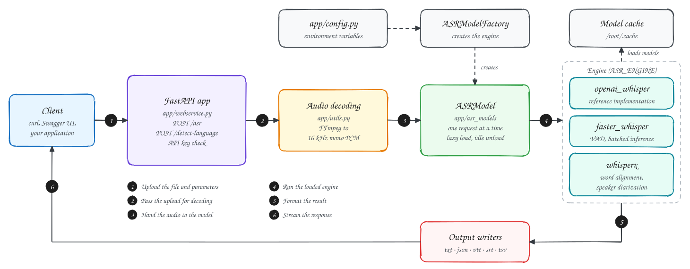

# Development

## Requirements

- Python 3.12 or 3.13
- [Poetry](https://python-poetry.org) 2.x
- For GPU support, an NVIDIA driver that supports CUDA 12.8 or newer

## Request Flow



The diagram source is [`request-flow.excalidraw`](assets/images/request-flow.excalidraw), which can be opened and
edited at [excalidraw.com](https://excalidraw.com).

## Project Structure

| Path                                 | Responsibility                                                       |
|--------------------------------------|----------------------------------------------------------------------|
| `app/webservice.py`                  | FastAPI application, endpoints, API key check and CLI entry point    |
| `app/config.py`                      | Reads the environment variables                                      |
| `app/utils.py`                       | Audio decoding with PyAV and the output format writers               |
| `app/factory/asr_model_factory.py`   | Creates the engine selected by `ASR_ENGINE`                          |
| `app/asr_models/asr_model.py`        | Engine base class: model lock, lazy loading and idle unloading       |
| `app/asr_models/*_engine.py`         | `openai_whisper`, `faster_whisper` and `whisperx` implementations    |
| `tests/`                             | API and audio decoding tests                                         |

## Install

```shell
poetry install                # CPU build of PyTorch
poetry install --extras cuda  # PyTorch for CUDA 12.8
```

## Run

```shell
poetry run whisper-asr-webservice --host 0.0.0.0 --port 9000
```

Configure the service with the [environment variables](environmental-variables.md), for example
`ASR_ENGINE=faster_whisper ASR_MODEL=tiny poetry run whisper-asr-webservice`.

## Test and Lint

```shell
poetry run pytest
poetry run ruff check app tests
```

The tests replace the ASR engine with a stub, so they run without downloading models.

## Build Docker Images

=== "CPU"

    ```shell
    docker build -t whisper-asr-webservice .
    docker run -d -p 9000:9000 whisper-asr-webservice
    ```

=== "GPU"

    ```shell
    docker build -f Dockerfile.gpu -t whisper-asr-webservice-gpu .
    docker run -d --gpus all -p 9000:9000 whisper-asr-webservice-gpu
    ```

=== "Docker Compose"

    ```shell
    docker compose up --build                            # CPU
    docker compose -f docker-compose.gpu.yml up --build  # GPU
    ```

    The Compose files mount `./app` into the container, so code changes take effect after a restart without a rebuild.

## Documentation

```shell
poetry run mkdocs serve
```

The site is served at <http://localhost:8000> and reloads on changes.

## Releases

Pushing a version tag publishes the Docker images, creates a GitHub release and deploys this documentation.
Pushing to the `debug` branch publishes the `debug` and `debug-gpu` images for testing.

Each architecture is built on a native GitHub runner and scanned with Trivy before the multi-platform tags are
published, so a failed scan never updates a published tag. The per-architecture images stay available as
`<tag>-amd64`, `<tag>-arm64` and `<tag>-gpu-amd64`. Builds of the `debug` branch reuse the layer cache stored in the
`buildcache-*` tags; version tags are always built from scratch.
