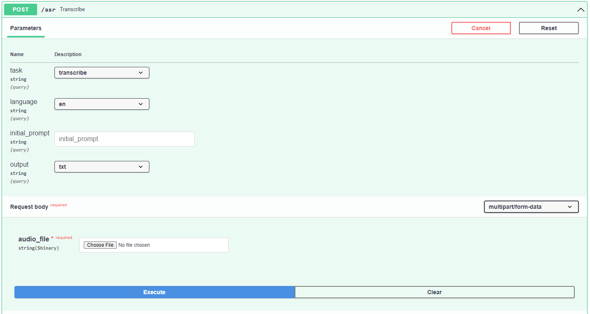

# Installation

The service is published on [Docker Hub](https://hub.docker.com/r/onerahmet/openai-whisper-asr-webservice) as
`onerahmet/openai-whisper-asr-webservice`.

| Tag             | Platforms                    | Description                    |
|-----------------|------------------------------|--------------------------------|
| `latest`        | `linux/amd64`, `linux/arm64` | Latest release, CPU            |
| `latest-gpu`    | `linux/amd64`                | Latest release, NVIDIA GPU     |
| `<version>`     | `linux/amd64`, `linux/arm64` | A specific release, CPU        |
| `<version>-gpu` | `linux/amd64`                | A specific release, NVIDIA GPU |

Pin a version tag (for example `v1.10.0`) in production so that upgrades happen only when you choose. All releases are
listed on the [releases page](https://github.com/ahmetoner/whisper-asr-webservice/releases).

## CPU

```shell
docker run -d -p 9000:9000 \
  -e ASR_ENGINE=faster_whisper \
  -e ASR_MODEL=base \
  onerahmet/openai-whisper-asr-webservice:latest
```

The CPU image also runs on Apple Silicon. Docker on macOS cannot access the GPU, so containers there always run on the
CPU.

## GPU

```shell
docker run -d --gpus all -p 9000:9000 \
  -e ASR_ENGINE=faster_whisper \
  -e ASR_MODEL=base \
  onerahmet/openai-whisper-asr-webservice:latest-gpu
```

Requirements:

- An NVIDIA driver that supports CUDA 12.8 or newer
- The [NVIDIA Container Toolkit](https://docs.nvidia.com/datacenter/cloud-native/container-toolkit/latest/install-guide.html)

## Docker Compose

```yaml
services:
  whisper:
    image: onerahmet/openai-whisper-asr-webservice:latest-gpu
    environment:
      - ASR_ENGINE=faster_whisper
      - ASR_MODEL=large-v3
      - MODEL_IDLE_TIMEOUT=300
    ports:
      - "9000:9000"
    volumes:
      - whisper-cache:/root/.cache
    deploy:
      resources:
        reservations:
          devices:
            - driver: nvidia
              count: 1
              capabilities: [gpu]

volumes:
  whisper-cache:
```

For the CPU image, use the `latest` tag and remove the `deploy` section.

## Model Cache

Models are downloaded on first start. Large models can take several minutes to download, so mount a volume at
`/root/.cache` to keep them between container restarts:

```shell
docker run -d -p 9000:9000 \
  -v $PWD/cache:/root/.cache \
  onerahmet/openai-whisper-asr-webservice:latest
```

!!! note
    Cached models are not re-downloaded, so you will not receive upstream model updates until you clear the cache.

## Verify

Once the container is running, open <http://localhost:9000/docs> to see the interactive API documentation.


